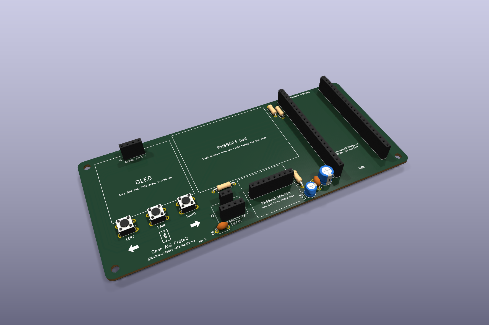
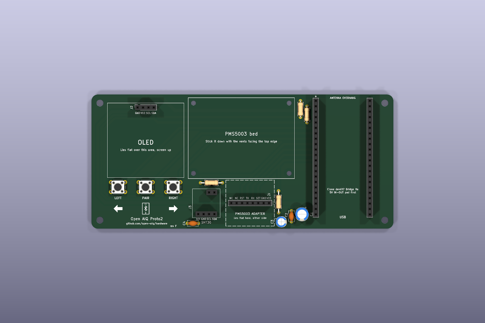
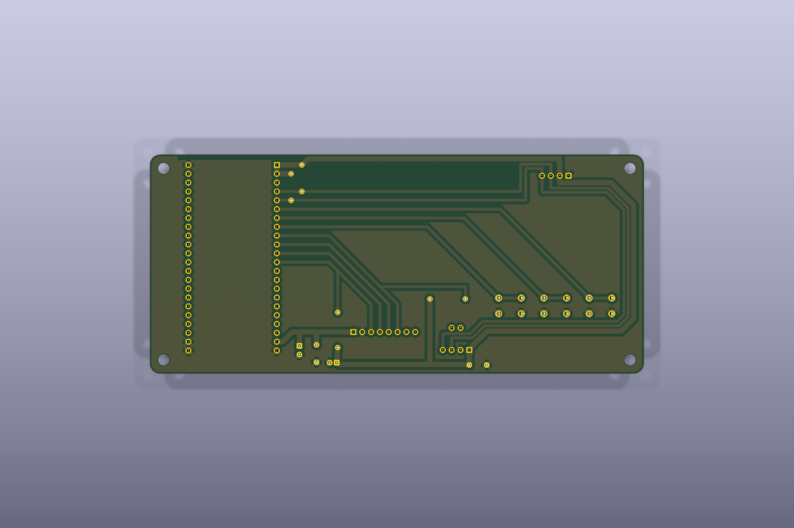

# Proto2: devkit carrier

Proto2 is the board we use to get Open AIQ off the breadboard. The OLED sits
top-left with three buttons under it, the sensors take the middle, and your
ESP32-S3 devkit plugs into two sockets on the right with its antenna past the
top edge. It's single-sided (all copper on the bottom) and everything is
through-hole, so you can solder it by hand and get it made almost anywhere.



| Top | Bottom |
| --- | --- |
|  |  |

## What's on it

| Ref | Part | Wiring |
| --- | --- | --- |
| U1 | ESP32-S3-DevKitC-1, or a pin-compatible clone, on two 1×22 sockets 25.4 mm (1.0 in) apart | All signals are on the left header. USB faces the bottom edge |
| J1 | PMS5003 particulate sensor, through its 1.25 mm to 2.54 mm adapter board, on a 1×8 socket | `VCC GND SET RX TX RST NC NC`, the sensor's own order, printed on the board. 5 V, UART on GPIO 18 (ESP TX) / 17 (ESP RX), SET on GPIO 8, RESET on GPIO 16 |
| J2 | 1.3 in SH1106 128×64 I2C OLED module, 4-pin socket | I2C, `GND VCC SCL SDA` from left to right, the order printed on the module's front. The module lies flat over the OLED box |
| J3 | SHT30 breakout with 6 pins, on a 1×4 and a 1×2 socket 10.16 mm apart | I2C, `SDA SCL GND VIN` from left to right on the silkscreen. The 2 pins on the far edge sit opposite SCL and SDA and are for support only |
| SW1, SW2, SW3 | Right, left and pair buttons, 6 × 6 mm 4-leg tactile switches | GPIO 15, GPIO 6 and GPIO 7, active-low |
| R1, R2 | 4.7 kΩ I2C pull-ups | SDA (GPIO 5), SCL (GPIO 4) to 3.3 V, under the OLED module |
| R3, R4 | 10 kΩ pull-ups | SET (R3) and RESET (R4), so the PMS5003 stays awake and out of reset unless the firmware says otherwise. In the `PMS PULL-UPS` box, between the SHT30 and J1 |
| C1–C4 | Bulk and decoupling capacitors | 47 µF + 100 nF on 5 V (C1, C2) and 10 µF + 100 nF on 3.3 V (C3, C4). All four sit under the devkit, between its sockets, so they need to be low-profile parts |

The pins match [`src/board.rs`](https://github.com/open-aiq/device/blob/main/src/board.rs)
in open-aiq/device. Rev B moved several pins so every trace fits on one side of
the board, so flash firmware with the matching `board.rs` before you plug a
devkit in. Older breadboard builds used the previous map (SDA 8, SCL 9, buttons
4 and 5), which you'll find in the firmware README. A few pins are worth knowing
about:

- **SW3 Pair (GPIO 7)** starts BLE pairing with the phone app when you hold it
  for 3 s. Holding left and right together does the same.
- **SET and RESET** have pull-ups that keep the sensor running while the
  devkit boots. The firmware drives SET low to rest the sensor between
  readings, and pulses RESET low to restart it if a whole burst brings no
  readings.

Everything to print is in [`proto2.pdf`](proto2.pdf): the schematic, the bottom
copper (mirrored, as you'd see it from below), a drill map of every hole by
size, and three 3D renders (an angled view, the top and the bottom). Every page
is A4. The bottom copper is 1:1, so print it at 100% ("Actual size", not "Fit to
page") and the board outline measures 147 × 75.5 mm. You can lay your parts on
the paper to check the fit before you order. The drill map is scaled to fit.
Wondering why a part is there, or why it has that value?
[`proto2-rationale.pdf`](proto2-rationale.pdf) walks through every component and
pin choice, with references to the datasheets.

## Revisions

- **Rev H** (this one) is about home etching and reading the board.
  The schematic now joins every part with real wires; only ground, 3.3 V and
  5 V use power symbols. Signal tracks widen from 1.0 to 1.2 mm and the 5 V
  feed to 2.0 mm, and tracks that run side by side keep an even gap. The
  ground fill is never narrower than 1 mm: KiCad drops anything thinner, and
  a DRC rule in `proto2.kicad_dru` flags a neck that's still carrying a
  connection. Dead-end strips of fill that reach no ground pin (the wedges
  between the button tracks, under the PMS5003 bed and between the devkit and
  J1) are cut back with `No ground finger` rule areas, with 45° corners. R1
  and R2 (I2C pull-ups) lie flat under the OLED module, and C1–C4 use the 1 cm
  of space under the devkit, right beside its 3V3 and 5V pins. The SHT30
  socket, R3 and R4 (in the `PMS PULL-UPS` box) and J1 sit in one row along
  the bottom, J1 next to the devkit, so the 5 V feed is one straight track.
  The PMS5003 bed sits 10 mm further right to leave the OLED some room, and
  the buttons sit 3 mm lower. R3 and R4 move to a 7.62 mm pitch, and J3 turns
  round (its pins now read `SDA SCL GND VIN`). The board grows to 147 × 75.5 mm to
  make room, and the bottom copper under the devkit says `Open AIR IQ`. The
  silkscreen is bold and uppercase with rounded double-line boxes, and the
  devkit's pin names are printed inside its sockets. We also gave it a friendlier
  face: the OLED box smiles and says hello, and the bottom has a little scene
  with our monitor waving from the hills and a thank-you note. The pin map
  matches rev G.
- **Rev G** widens the gap around the ground fill from 0.8 to
  0.9 mm, so there's more room between ground and every other track. To keep
  the SHT30's ground pin on the fill, the 3.3 V track to R4 moved 0.4 mm
  right. Nothing else moved, and the pin map and parts match rev F.
- **Rev F** adds four M2 holes so you can screw the PMS5003 to
  the board, on the sensor's own 45 × 33 mm hole pattern. It also fixes the
  SHT30 socket: the 2-pin row now sits opposite SCL and SDA, 10.16 mm from
  the 4-pin row, which is where the pins are on a real breakout (rev E had it
  6.35 mm away, opposite GND and SCL). Signal tracks widen again, from 0.8 to
  1.0 mm, with the I²C pair re-spaced to fit, and SDA now runs straight into
  the OLED socket instead of looping over it. Two tracks moved to stay clear
  of the screw heads. The pin map and the other parts match rev E.
- **Rev E** swaps the tiny 1.25 mm PMS5003 connector for a 1×8,
  2.54 mm socket that takes the sensor's adapter board, with a clear area
  around it so the adapter can lie flat. Every track is wider and further
  apart: signals 0.8 mm, power 1.5 mm, at least 0.4 mm between them, and
  0.8 mm around the ground fill. There are no narrow spots left, and ground
  comes entirely from the fill. To make room, R3, R4, C1–C4 moved, R1 and R2
  use a 7.62 mm pitch, and the OLED socket and its area sit 2.5 mm lower.
  The pin map is the same as rev D.
- **Rev D** widens the copper wherever there's room. Signal tracks
  go from 0.3 to 0.5 mm (0.4 or 0.3 mm where they squeeze between header
  pins), most power and ground tracks from 0.8 to 1.0 mm, and the ground fill
  keeps 0.5 mm from everything else, up from 0.3 mm. That makes it kinder to
  hand soldering and home etching. Nothing moved, so the parts, pins and
  silkscreen match rev C apart from the rev label.
- **Rev C** rotates the OLED socket so it reads `GND VCC SCL SDA`,
  the order printed on the module. Rev B had it mirrored, which would have
  swapped 3.3 V and ground. It also widens the ground tracks where there's
  room and changes C1 from 100 µF to 47 µF. The pin map is the same as rev B.
- **Rev B** made the board single-sided, added the pair button and moved to
  today's pin map.
- **Rev A** was the first, two-layer carrier.

## Before you build

- **Check your OLED's pin order.** The socket reads `GND VCC SCL SDA` from left
  to right, and the silkscreen says so too. Hold your module face-up with its
  pins along the top: its labels should read the same. Some modules swap GND
  and VCC, and plugging one in backwards can damage it.
- **Clone devkits need the 5 V pad bridged.** Many DevKitC-1 clones have an
  `IN-OUT` solder jumper next to the 5V pin. Until you bridge it, USB power
  doesn't reach that pin, and the PMS5003 stays dark. Once it's bridged, don't
  feed 5 V into the pin while USB is plugged in.
- **C1–C4 sit under the devkit.** There's about 1 cm between the board and
  the devkit, so pick capacitors no taller than 8 mm (see [Parts](#parts)),
  and plug the devkit in once to check it seats fully before you solder them.
- **The OLED lies flat over its box.** It plugs into J2 face-up and
  rests over that area, so the only parts under it are R1 and R2, lying flat.
  Solder those before you fit the screen. If your module sits lower than the
  socket's usual 8.5 mm, check they clear it.
- **Check your SHT30 against the socket.** The 2-pin row sits 10.16 mm
  (4 breadboard holes) from the 4-pin row, opposite SCL and SDA, as measured on
  our breakout. If yours differs, the 4-pin row still works, and you can leave
  the 1×2 socket out.
- **The PMS5003 plugs in through its adapter board.** The sensor's cable goes
  into the adapter, and the adapter's 8 pins go into J1. It lies flat over the
  dashed area beside J1, on whichever side its pins come out. We sized that
  area from a photo (an adapter of about 22 × 10 mm), so measure yours first.
  Check that the adapter's pin labels match `VCC GND SET RX TX RST NC NC` on
  the board before you plug it in.
- **The PMS5003 sits on the marked bed.** Fix it with four M2 self-tapping
  screws from below, through the holes in the bed's corners and into the
  sensor's case, or stick it down with double-sided foam tape. Keep the vents
  facing the top edge so it doesn't pull in warm air from the devkit. The
  bottom copper stays clear around each hole, so a screw head can't touch a
  track. Its case is metal, but there's no copper on top, so it can't short
  anything.
- **The devkit's antenna hangs off the top edge.** That's on purpose: copper
  under an antenna weakens WiFi and BLE, so the ground fill also stops short of
  that end. Its USB end sits about 12 mm in from the bottom edge, with nothing
  tall underneath, so a USB plug still fits.
- **R8 modules use GPIO 35, 36 and 37 for PSRAM.** Proto2 leaves them
  unconnected, so keep it that way if you add anything.
- **The status LED is on the devkit.** The firmware drives both GPIO 48
  (DevKitC-1 v1.0) and GPIO 38 (v1.1), so it lights on either. Proto2 leaves
  both pins free.

## First power-up

A few quick checks before you trust the readings:

1. **Check the PMS5003 cable and adapter with a multimeter first.** Pin 1 on
   the sensor should reach the adapter pin that sits in J1's `VCC`. Some cables
   and adapters come wired in reverse. That won't damage anything, but the
   sensor stays silent.
2. **Measure 5 V at J1 pin 1 with the fan running.** The PMS5003 needs at least
   4.5 V. A long or thin USB cable, plus the devkit's own power path, can pull
   the 5V pin below what your charger supplies.
3. **Read the serial log.** The I2C scan at boot should find `0x3C` (OLED) and
   `0x44` (SHT30).
4. **Look at the screen.** It should read upright with the pins at the top. If it
   shows upside down, the firmware's display setup notes how to flip it.

## Parts

You'll find the generated list in [`fab/proto2-bom.csv`](fab/proto2-bom.csv).
To buy them:

| Qty | Part | Notes |
| --- | --- | --- |
| 2 | 1×22 female header, 2.54 mm | Sockets for the devkit (U1) |
| 2 | 1×4 female header, 2.54 mm | OLED (J2) and SHT30 (J3) |
| 1 | 1×2 female header, 2.54 mm | SHT30's far-edge pins (J3) |
| 1 | 1×8 female header, 2.54 mm | PMS5003 adapter board (J1). The adapter usually comes with the sensor's cable |
| 3 | 6 × 6 mm through-hole tactile switch, 4-leg (for example Omron B3F-1000) | SW1, SW2, SW3 |
| 2 | 4.7 kΩ resistor, 1/4 W axial | R1, R2. These sit on a 7.62 mm pitch, so bend the legs close to the body |
| 2 | 10 kΩ resistor, 1/4 W axial | R3, R4, also on a 7.62 mm pitch |
| 1 | 47 µF electrolytic, ≥10 V, 6.3 mm radial, 2.5 mm pitch, low-profile (about 5 mm tall, 8 mm at most) | C1. It sits under the devkit, so the usual 11 mm part is too tall |
| 1 | 10 µF electrolytic, ≥10 V, 5 mm radial, 2 mm pitch, low-profile (about 5 mm tall, 8 mm at most) | C3, also under the devkit |
| 2 | 100 nF ceramic, 5 mm pitch, 8 mm tall at most | C2, C4, also under the devkit |
| 4 | M2 self-tapping screw, pan head, about 5 mm long | Optional, to hold the PMS5003 (H5). Use one short enough not to reach inside the sensor |

## Ordering

[`fab/proto2-gerbers.zip`](fab/proto2-gerbers.zip) holds the Gerbers and
Excellon drill files: bottom copper, bottom solder mask, top and bottom
silkscreen, the outline and drills. Upload it to JLCPCB, PCBWay or a local shop as it is. We
haven't placed an order yet, so treat these settings as our first guess:

| Setting | Value |
| --- | --- |
| Size | 147 × 75.5 mm |
| Layers | Order it as 2-layer: you get plated holes, and the top side has pads only. The copper is all on the bottom, so a 1-layer order or home etching works too; unplated pads just lift more easily if you resolder them |
| Thickness | 1.6 mm |
| Min track / clearance | 1.2 / 0.4 mm (power 1.5 mm, the 5 V feed 2.0 mm), with 0.9 mm around the ground fill, which is never narrower than 1 mm |
| Min hole | 0.8 mm (resistor and capacitor leads), plus four 2.2 mm holes for the PMS5003 screws; no vias |
| Surface finish | HASL is fine |

Every part is through-hole, so there's no pick-and-place file.

## Editing

Open `proto2.kicad_pro` in KiCad 10. The repo's [Working in KiCad](../../README.md#working-in-kicad)
guide covers libraries, rules and outputs. These are ours, in [`lib/`](../../lib):

- the devkit, SHT30 and PMS5003 adapter socket footprints, and the PMS5003
  mounting holes (a board-only footprint with a copper keep-out for each
  screw head). The devkit socket marks its
  GND pins and its two 3V3 pins as joined inside the devkit (KiCad *jumper pad
  groups*), so they don't need tracks between them
- the arrow and phone-with-Bluetooth icons under the buttons, which are
  board-only footprints you can move
- the sensor symbols

The `Open AIR IQ` text on the bottom copper uses
[Orbitron](https://fonts.google.com/specimen/Orbitron), a free font. Install it
before you edit the board, or KiCad swaps in its own font and the letters
change shape. The Gerbers already carry the right outlines.

To refresh the outputs, run `proto2.kicad_jobset` in KiCad, or this from the repo
root:

```sh
scripts/export.sh pcb/proto2
```

Both stop if ERC or DRC finds a problem. The home-etching rules (1.2 mm
signals, 1.5 mm power, no ground neck under 1 mm) live in
[`proto2.kicad_dru`](proto2.kicad_dru), next to the board.

The design rationale is written in [Typst](https://typst.app). If you change a
part, update `proto2-rationale.typ` too, then rebuild the PDF from this folder:

```sh
typst compile proto2-rationale.typ
```
