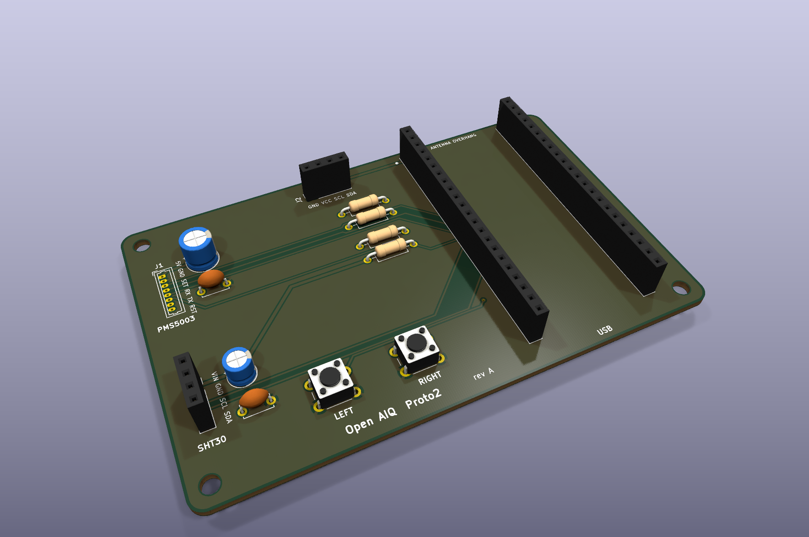
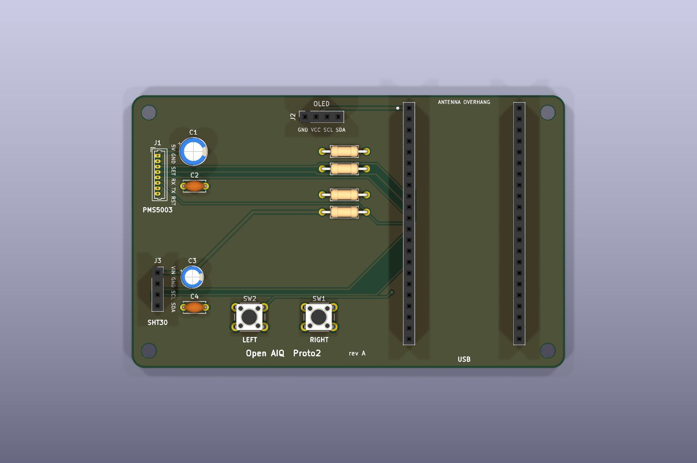
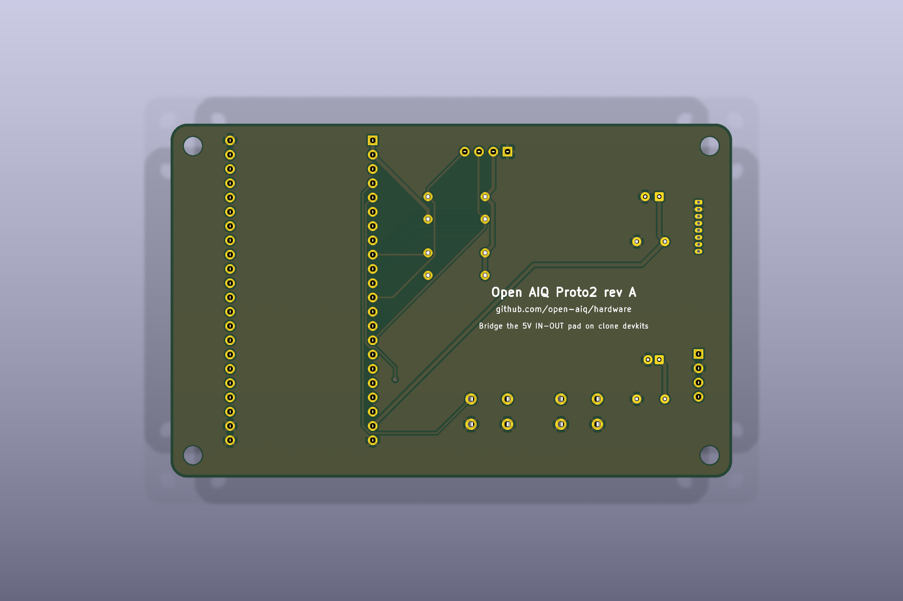

# Proto2: devkit carrier

Proto2 is the board we use to get Open AIQ off the breadboard. Your ESP32-S3
devkit plugs into two sockets, and the sensors, display and buttons plug into
labelled connectors around it. Everything is through-hole, so you can solder it
by hand.



| Top | Bottom |
| --- | --- |
|  |  |

## What's on it

| Ref | Part | Wiring |
| --- | --- | --- |
| U1 | ESP32-S3-DevKitC-1, or a pin-compatible clone, on two 1×22 sockets 25.4 mm (1.0 in) apart | All signals are on the left header |
| J1 | PMS5003 particulate sensor, 8-pin 1.25 mm connector | 5 V, UART on GPIO 17 (TX) / 18 (RX), SET on GPIO 16, RESET on GPIO 15 |
| J2 | 1.3 in SH1106 OLED, 4-pin socket | I2C, `GND VCC SCL SDA` |
| J3 | SHT30 breakout, 4-pin socket | I2C, `VIN GND SCL SDA` |
| SW1, SW2 | Right and left buttons | GPIO 4 and GPIO 5, active-low |
| R1, R2 | 4.7 kΩ I2C pull-ups | SDA (GPIO 8), SCL (GPIO 9) to 3.3 V |
| R3, R4 | 10 kΩ pull-ups | Keep the PMS5003 awake and out of reset unless the firmware says otherwise |
| C1–C4 | Bulk and decoupling capacitors | 100 µF + 100 nF on 5 V, 10 µF + 100 nF on 3.3 V |

The pins match [`src/board.rs`](https://github.com/open-aiq/device/blob/main/src/board.rs)
in open-aiq/device, so the current firmware runs unchanged. SET and RESET are
extras: their pull-ups keep the sensor running, and the firmware can use them
later to rest the sensor between readings.

The schematic is in [`proto2.pdf`](proto2.pdf), and [`proto2-assembly.pdf`](proto2-assembly.pdf) shows where each part goes.

## Before you build

- **Check your OLED's pin order.** We expect `GND VCC SCL SDA`. Some modules
  swap GND and VCC, and plugging one in backwards can damage it.
- **Clone devkits need the 5 V pad bridged.** Many DevKitC-1 clones have an
  `IN-OUT` solder jumper next to the 5V pin. Until you bridge it, USB power
  doesn't reach that pin, and the PMS5003 stays dark. Once it's bridged, don't
  feed 5 V into the pin while USB is plugged in.
- **The devkit's antenna hangs off the top edge.** That's on purpose: copper
  under an antenna weakens WiFi and BLE.
- **R8 modules use GPIO 35, 36 and 37 for PSRAM.** Proto2 leaves them
  unconnected, so keep it that way if you add anything.

## Parts

You'll find the generated list in [`fab/proto2-bom.csv`](fab/proto2-bom.csv).
To buy them:

| Qty | Part | Notes |
| --- | --- | --- |
| 2 | 1×22 female header, 2.54 mm | Sockets for the devkit (U1) |
| 2 | 1×4 female header, 2.54 mm | OLED (J2) and SHT30 (J3) |
| 1 | Molex PicoBlade 53047-0810, 8-pin vertical | PMS5003 (J1). Check that it fits your sensor's cable first |
| 2 | 6 × 6 mm through-hole tactile switch | SW1, SW2 |
| 2 | 4.7 kΩ resistor, 1/4 W axial | R1, R2 |
| 2 | 10 kΩ resistor, 1/4 W axial | R3, R4 |
| 1 | 100 µF electrolytic, ≥10 V, 6.3 mm radial, 2.5 mm pitch | C1 |
| 1 | 10 µF electrolytic, ≥10 V, 5 mm radial, 2 mm pitch | C3 |
| 2 | 100 nF ceramic, 5 mm pitch | C2, C4 |

## Ordering

[`fab/proto2-gerbers.zip`](fab/proto2-gerbers.zip) holds the Gerbers and
Excellon drill files. Upload it to JLCPCB or PCBWay as it is. We haven't placed
an order yet, so treat these settings as our first guess:

| Setting | Value |
| --- | --- |
| Size | 100 × 63 mm |
| Layers | 2 |
| Thickness | 1.6 mm |
| Min track / clearance | 0.3 / 0.2 mm (power 0.6 mm) |
| Min hole | 0.4 mm vias |
| Surface finish | HASL is fine |

Every part is through-hole, so there's no pick-and-place file.

## Editing

Open `proto2.kicad_pro` in KiCad 10. The repo's [Working in KiCad](../../README.md#working-in-kicad)
guide covers libraries, rules and outputs. The devkit socket footprint and the
sensor symbols are ours, in [`lib/`](../../lib).

To refresh the outputs, run `proto2.kicad_jobset` in KiCad, or this from the repo
root:

```sh
scripts/export.sh pcb/proto2
```

Both stop if ERC or DRC finds a problem.
