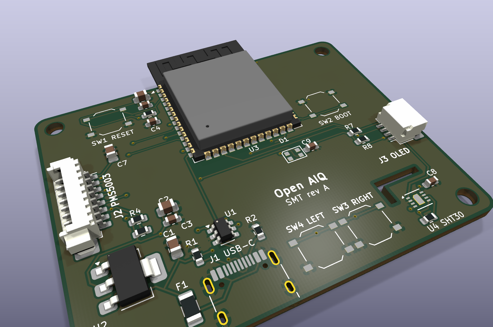
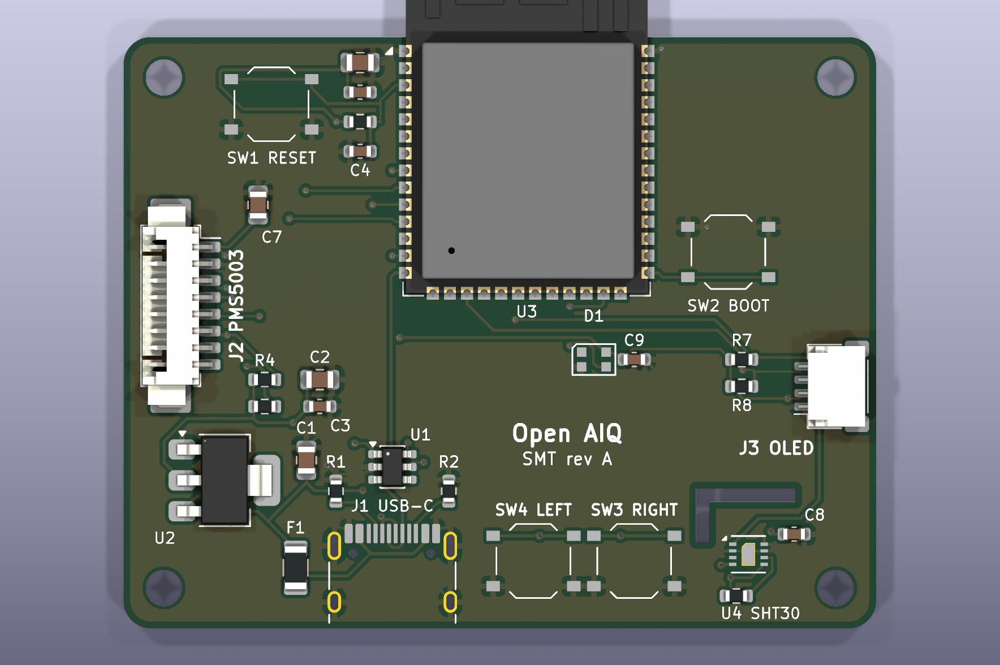
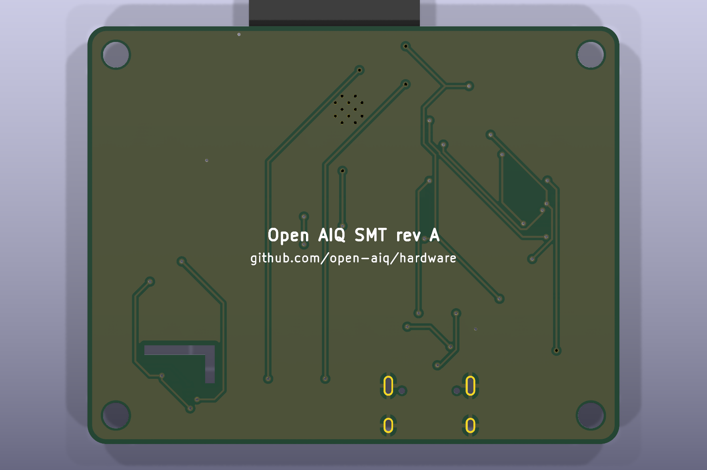

# SMT board (rev A)

This is the first Open AIQ board with the ESP32-S3 on it, instead of on a devkit.
It does everything Proto2 does in a 56 × 44 mm board that JLCPCB can assemble
for you. You plug in the PMS5003's own cable and the OLED's Qwiic lead, and power
it from one USB-C port.



| Top | Bottom |
| --- | --- |
|  |  |

> **Status: designed, not yet ordered.** ERC and DRC pass with no errors, but no board
> has been built yet. Please read [Check before ordering](#check-before-ordering).

## What's on it

| Ref | Part | LCSC | Why |
| --- | --- | --- | --- |
| U3 | ESP32-S3-WROOM-1-N16R8 | C2913202 | Same module as the devkit: 16 MB flash, 8 MB PSRAM |
| J1 | USB-C receptacle, HRO TYPE-C-31-M-12 | C165948 | Power plus the S3's built-in USB Serial/JTAG for flashing, logs and debugging |
| U1 | USBLC6-2SC6 | C7519 | ESD protection on the USB data lines |
| F1 | 1.1 A resettable fuse (1206) | C7542963 | Protects your laptop's port if something shorts |
| U2 | AMS1117-3.3 | C6186 | 5 V to 3.3 V |
| J2 | 1.25 mm 8-pin side-entry connector | C2681529 | The PMS5003 cable from the box plugs in here |
| J3 | JST SH 4-pin (Qwiic), SM04B-SRSS-TB | C160404 | OLED on a cable: `GND 3V3 SDA SCL` |
| U4 | SHT30-DIS-B | C77361 | Temperature and humidity, on its own slotted corner |
| D1 | WS2812B-2020 | C965555 | Status LED on GPIO 48, like the devkit |
| SW1–SW4 | TS-1187A tactile switches | C318884 | RESET, BOOT, LEFT, RIGHT |

The full list is in [`fab/smt-jlc-bom.csv`](fab/smt-jlc-bom.csv). The schematic is in
[`smt.pdf`](smt.pdf), and [`smt-assembly.pdf`](smt-assembly.pdf) shows where each part goes.

### Pins

The pins match [`src/board.rs`](https://github.com/open-aiq/device/blob/main/src/board.rs)
and Proto2. SET, RESET and the LED are new, and the firmware doesn't use them yet:

| Signal | GPIO |
| --- | --- |
| I2C SDA / SCL (OLED, SHT30) | 8 / 9 |
| PMS5003 TX / RX (ESP side) | 17 / 18 |
| PMS5003 SET / RESET | 16 / 15 |
| Buttons RIGHT / LEFT | 4 / 5 |
| Status LED | 48 |
| USB D- / D+ | 19 / 20 |
| BOOT | 0 |

## Things worth knowing

- **One USB-C port does everything.** The ESP32-S3 has USB built in, so there's
  no USB-to-serial chip. Flashing, the serial console and JTAG debugging all go
  over the same cable. The firmware needs its console on USB Serial/JTAG
  (`CONFIG_ESP_CONSOLE_USB_SERIAL_JTAG`) for logs to show up.
- **The antenna hangs off the top edge.** That's on purpose: copper under the
  antenna weakens WiFi and BLE, so keep the enclosure's walls clear of it too.
- **The SHT30 sits behind a slot.** The cut-out keeps heat from the module and
  the regulator away from the sensor, so the temperature reading stays honest.
- **SET and RESET have pull-ups.** The PMS5003 keeps running if the firmware
  ignores them, and the firmware can use SET later to rest the sensor between
  readings.

## Check before ordering

We haven't built this board yet. These are the spots most likely to need a fix,
so give them a look before you place an order:

1. **PMS5003 connector fit.** C2681529 is a generic 1.25 mm side-entry header, and
   we used KiCad's Molex PicoBlade 53261 footprint for it. Compare the LCSC
   drawing with the footprint, and try the sensor's cable in a sample connector
   if you can.
2. **Part rotations in JLCPCB's preview.** KiCad and JLCPCB sometimes disagree on
   zero rotation, especially for the module, USB-C, the LED and the SOT-223
   regulator. Fix any that look turned in the assembly preview.
3. **The WS2812B runs at 3.3 V.** That keeps the data signal in spec without a
   level shifter, and it's common practice, but the LED is rated from 3.5 V.
   If it misbehaves, the fix is a 5 V supply plus a level shifter.
4. **Stock.** LCSC numbers were checked on 2026-11-08. Re-check stock when you order.

## Making it

Upload [`fab/smt-gerbers.zip`](fab/smt-gerbers.zip) to JLCPCB, turn on assembly
(top side), then add [`fab/smt-jlc-bom.csv`](fab/smt-jlc-bom.csv) and
[`fab/smt-jlc-cpl.csv`](fab/smt-jlc-cpl.csv).

| Setting | Value |
| --- | --- |
| Size | 56 × 44 mm |
| Layers | 2 |
| Thickness | 1.6 mm |
| Min track / clearance | 0.2 / 0.15 mm (power 0.4 mm) |
| Vias | 0.6 mm pad, 0.3 mm drill |
| Assembly | Top side, all parts |

## Editing

Open `smt.kicad_pro` in KiCad 10. The repo's [Working in KiCad](../../README.md#working-in-kicad)
guide covers libraries, rules and outputs. A few things specific to this board:

- **Two footprints are our own copies.** They live in [`lib/`](../../lib):
  `ESP32-S3-WROOM-1_JLC` has 0.3 mm thermal vias, and
  `USB_C_Receptacle_HRO_TYPE-C-31-M-12_BoardEdge` has its silkscreen trimmed at
  the board edge. Edit them there, not on the board.
- **The SHT30 slot has keep-out zones.** They're the rule areas along the slot on
  both copper layers, and they stop traces from crowding the cut-out. If you
  move the slot, move them too.
- **Some reference designators only show on the assembly drawing.** Five small
  parts (C5, C6, R3, R5, R6) had no room for silkscreen labels. They're
  labelled in [`smt-assembly.pdf`](smt-assembly.pdf), along with every other part.
- **The traces came from an autorouter.** Feel free to clean them up by hand.
  Keep the USB D+/D- pair short and side by side, and keep copper away from the
  antenna edge.

To refresh the outputs, run the jobset in KiCad, or this from the repo root:

```sh
RENDER_ZOOM=1.15 scripts/export.sh pcb/smt
```

The board was first laid out by scripts. They're in this repo's history (commit
`fc827ce`, `pcb/smt/tools/`), but the KiCad files have moved on since, so don't
re-run them.
